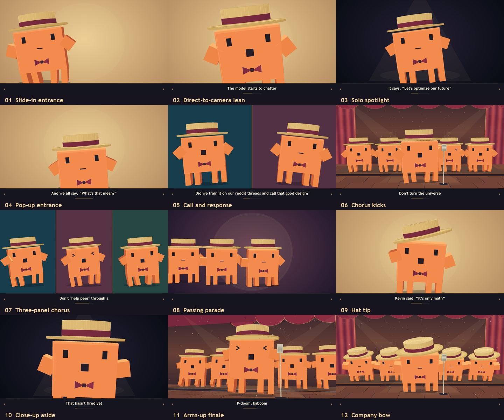

# P(doom)! Kaboom!

Input assets and source for the latest animated music video: the orange character
in a straw boater and bowtie, a clone chorus, changing stage and isolated shots,
bottom lyrics, and a two-state mouth driven by the vocals.



## Contents

- `assets/audio/P(doom)! Kaboom!.m4a` — the original song, copied without re-encoding.
- `assets/character/` — all three original character references, copied without alteration.
- `assets/lyrics/lyrics.txt` — lyrics extracted from the song's embedded metadata.
- `assets/lyrics/source-lyrics.srt` — the original embedded lyric timing used for alignment.
- `assets/manifest.json` — SHA-256 checksums and sizes of the input assets.
- `src/create_video_v3.py` — current choreography, camera cuts, poses, mouth animation, and captions.
- `src/create_video_v2.py` and `src/create_video.py` — shared geometry and drawing helpers retained from earlier versions. Use `render.py` to render the current version.
- `data/` — saved vocal alignment, 100 Hz mouth timing, lyric cues, shot list, chapters, and subtitles. Rendering does not require downloading any models.
- `src/prepare_vocals.py`, `src/align_vocals.py`, and `src/build_mouth_track.py` — optional scripts for rebuilding the vocal timing.
- `docs/original-v3-validation.json` — validation measurements from the previously delivered full video.

Rendered movies, decoded audio, virtual environments, and model caches are excluded
from Git. The reference images guide the character design; the renderer draws its
geometry procedurally and does not load the images into each frame.

## Render

The tested setup uses Python 3.12, FFmpeg on `PATH`, and macOS supplemental fonts:
Trebuchet MS Bold, Rockwell, Copperplate, and Baskerville. Fonts are not bundled.
Set `PDOOM_FONT_DIR` to another directory containing these font files if needed.

```sh
python3.12 -m venv .venv
source .venv/bin/activate
python -m pip install -r requirements.txt

# A single frame, then a short preview with the song.
python render.py --still 3.05
python render.py --start 1 --end 6

# Full 1920×1080 video, 30 fps, 151.6 seconds, with audio and burned-in lyrics.
python render.py
```

Results are written to `renders/`; scratch files go to `work/`. Full rendering is
CPU-intensive. Run `python src/v3_scene_sheet.py` to rebuild the scene overview
and poster. These commands can be run from any directory if the script paths are
adjusted; asset paths are resolved relative to the repository.

Edit `SHOTS` and `Performer` in `src/create_video_v3.py` to change the performance.
The renderer reads the saved captions from `data/v3-cues.json` and the binary mouth
track from `data/v3-mouth-track.npz`. The shot list JSON is a reference export;
the Python `SHOTS` list controls the edit.

## Optional: regenerate the vocal timing

The saved timing already captures the latest edit. To recompute it, use a separate
Python 3.12 environment. The first run downloads Demucs and Wav2Vec2 model weights;
processing then runs locally on the CPU. Model weights and extracted stems stay
in the ignored `work/` directory.

```sh
python3.12 -m venv .venv-audio
source .venv-audio/bin/activate
python -m pip install -r requirements-audio.txt
python src/prepare_vocals.py
python src/align_vocals.py
python src/build_mouth_track.py

# Adopt the newly generated timing for subsequent renders.
cp work/v3-aligned-characters.json work/v3-aligned-words.json data/
cp work/v3-mouth-track.npz work/v3-mouth-open-intervals.json work/v3-cues.json data/

# Return to the rendering environment.
source .venv/bin/activate
python render.py --start 1 --end 6
```

Review changed captions and transitions before rendering the full video. The
existing chapter metadata is fixed to this song. Rebuilt subtitles are written
alongside the full render; `data/P-doom-Kaboom-v3.srt` preserves the delivered edit.

## Asset provenance

The audio and three character images were supplied for this project. Renaming the
reference files did not change their contents. The lyrics text is extracted from
the supplied audio; the original user wording is retained in the lyric cues.
The source and timing data were created while making the video. No redistribution
license is inferred for the supplied assets, and no third-party fonts or model
weights are included.
